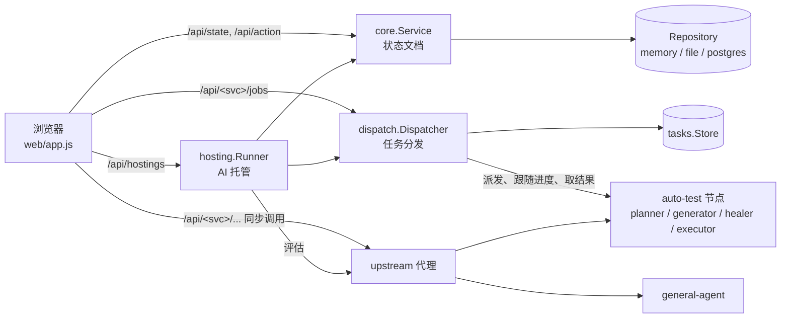
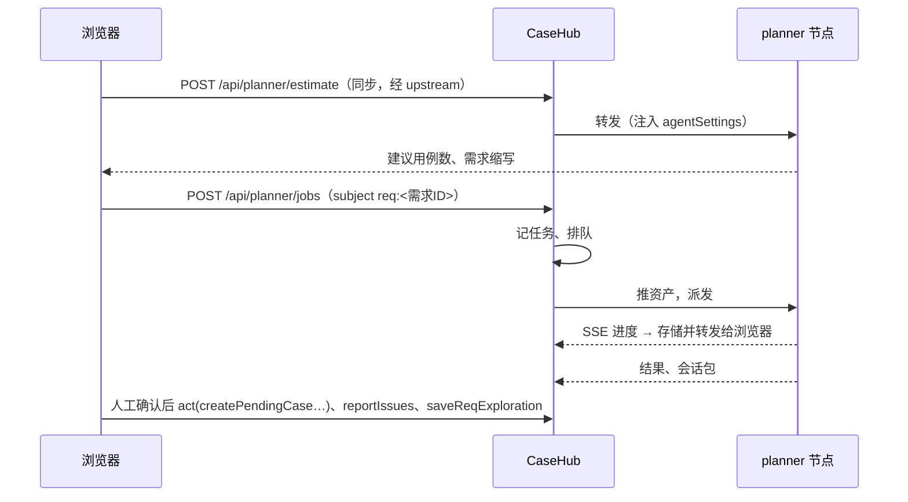
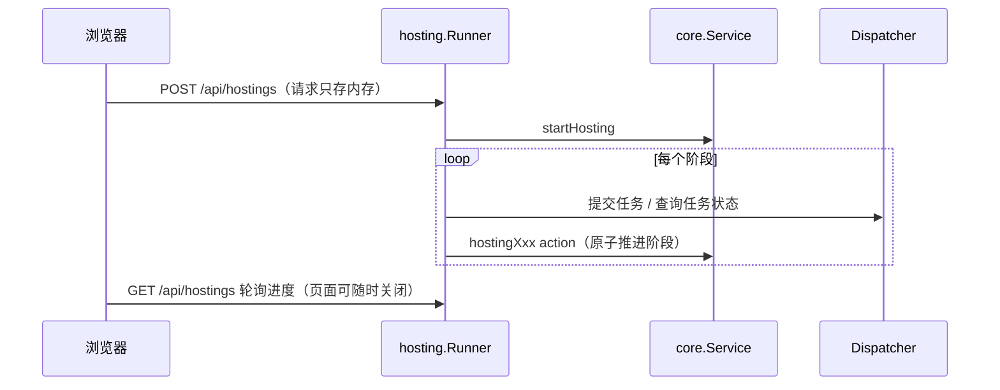

# CaseHub 项目结构与设计说明

> 面向要修改或扩展 CaseHub 的开发者：先讲清楚代码放在哪里、各部分怎么协作，再讲几条贯穿全局、改代码时不能破坏的设计约束。
> 功能清单、配置项和操作说明见 [README.md](../README.md)，部署见 [DEPLOYMENT.md](../DEPLOYMENT.md)。
> 最早的需求草稿是 [SYSTEM_DESIGN_TEMPLATE.md](../SYSTEM_DESIGN_TEMPLATE.md)，记录的是当初的目标，不代表现状。

## 1. 定位

CaseHub 是按版本管理测试用例的系统：主线只读，测试版本从主线派生，在测试版本里编辑用例、记录执行结果，再把文本变更合并回主线。在此之上，它还是 [auto-test](https://github.com/stainton/auto-test) 的**调度方和数据方**：

- auto-test 的 planner（用例设计）、generator / healer（脚本生成与修复）、executor（脚本执行）、general-agent（通用模型调用）都是**无状态节点**，它们不碰数据库，也从不主动访问 CaseHub。
- 需求、用例、脚本、探索记录、产品经验、资产、agent 配置和任务记录都存在 CaseHub。每次发任务时，CaseHub 把节点需要的东西放进请求里推过去，任务结束后再把结果取回来存好。

整个系统是**一个 Go 进程**：同一个 `net/http` 服务同时提供前端页面、业务 API、到 auto-test 的代理，以及任务分发。



## 2. 目录结构

```text
casehub/
├── main.go                 入口：选存储、建节点池、装配 dispatcher / 代理 / 托管，注册所有路由
├── hosting_api.go          /api/hostings 路由，以及托管调用 auto-test 服务的适配层
├── agent_settings.go       /api/agent-settings/{agent}[/runtime]：业务默认参数与 setting.json
├── assets.go               /api/assets、/api/record-images：上传文件与测试记录里的图片
├── internal/
│   ├── core/               领域模型与全部业务规则（无 HTTP、无数据库依赖）
│   │   ├── core.go         State / Action / Service.Apply，版本、用例、需求、评审、脚本、问题单……
│   │   ├── hosting.go      AI 托管的状态机（每一步是一个 action）
│   │   ├── agent_settings.go, assets.go, record_images.go
│   │   └── *_test.go
│   ├── store/              core.Repository 的三种实现：Memory、File、Postgres
│   ├── tasks/              任务记录（状态、进度事件、结果、会话包、诊断包）的存储：Local（内存/文件）、Postgres
│   ├── dispatch/           任务分发：节点池、排队、派发、跟随进度、取回结果、节点丢失处理、/metrics
│   ├── upstream/           到 auto-test 的反向代理：注入 agent 配置、推送资产、统一错误
│   └── hosting/            AI 托管的服务端执行器（goroutine 推进 core 里的托管状态机）
├── web/                    前端，经 go:embed 打进二进制
│   ├── index.html          页面骨架：顶栏页签、各页容器、抽屉、弹窗
│   ├── app.js              全部前端逻辑（无框架、无构建步骤）
│   ├── api.html / api.js   内置 API 文档页
│   ├── feishu-export.js    复制飞书思维导图
│   ├── *.css               样式（style.css 为基础，overrides.css 为后加的覆盖）
│   └── vendor/             TOAST UI Editor（Markdown 编辑器）
├── tests/*.cjs             Playwright 浏览器回归，各自带假的 auto-test 服务
├── deploy/kubernetes/      Kubernetes 清单
├── Dockerfile, compose.yaml, build.sh, build.ps1
└── docs/                   专题文档（本文、飞书导出）
```

依赖方向是单向的：`main` → `hosting` / `dispatch` / `upstream` / `store` → `core`、`tasks`。`core` 不依赖任何其他内部包，所有业务规则都能脱离 HTTP 和数据库单独测试。

## 3. 后端

### 3.1 core：一份状态文档 + 一组原子 action

CaseHub 的业务数据是**一个 `State` 文档**（`internal/core/core.go`），里面是各类实体的列表：

| 集合 | 内容 |
| --- | --- |
| `Versions` / `Folders` / `Cases` | 主线与测试版本、每个版本的目录树、用例（按 `VersionID` 区分） |
| `Histories` / `Records` / `Tasks` | 用例编辑历史、测试记录、测试任务（人工执行用的用例子集） |
| `ReqFolders` / `ReqDocs` | 需求树与需求文档（含需求缩写 `Code`、探索记录） |
| `PendingFolders` / `PendingCases` | 用例评审区：AI 设计出的用例先进这里，评审通过后导入测试版本 |
| `Scripts` / `ScriptVersions` | 每条用例的 Playwright 脚本及历史版本 |
| `Issues` | 问题单（人工创建，或由 planner / generator 发现的缺陷自动上报） |
| `ProductExperiences` | 按被测系统 origin 保存的产品级探索经验 |
| `KnowledgeFolders` / `KnowledgeDocs` | 知识库：全局库（`kb-root`）+ 每个主线产品一个产品库（`Product` 指向「全部用例」下的一级目录），产品库里的用例库文档（`Generated`）由 `syncProductKnowledge` 在每个 action 之后按主线重建 |
| `Hostings` | AI 托管的进度记录 |

所有修改都走 `POST /api/action`，请求体是一个 `Action`（`Type` 加上各类型用到的字段）。`Service.Apply` 在一把进程内的锁下执行 **加载 → 修改 → 保存**：

```go
st := repo.Load()
switch a.Type { case "createCase": err = createCase(&st, a) ... }
if err == nil { repo.Save(st) }
```

由此得到两条性质，后面很多设计都依赖它们：

- **每个 action 都是原子的**：要么整份状态都改好并保存，要么什么都不变。一个 action 里可以改很多实体（例如「导入评审用例」会同时建目录、搬用例、写历史），不需要事务代码。
- **串行**：同一时刻只有一个 action 在执行，不存在并发写冲突。代价是 CaseHub 只能**单副本**运行（见第 7 节）。

返回值是新的完整状态；前端用它整体替换本地的 `state` 再重绘。`GET /api/state` 读取整份状态（去掉 agent 配置）。

新增一类业务操作时：在 `core` 里写一个 `func xxx(s *State, a Action) error`，在 `Apply` 的 `switch` 里注册，前端用 `act('xxx', {...})` 调用。

### 3.2 版本模型

| 概念 | 实现 |
| --- | --- |
| 主线 | `VersionID == "main"`，只能通过合并修改；`State.MainRevision` 在每次合并时加一 |
| 测试版本 | 从主线复制（全部或勾选的用例），之后独立编辑；归档（`Archived`）后只读 |
| 冲突检测 | 主线用例的 `Revision` 是它最后一次被合并时的 `MainRevision`；分支用例的 `BaseRevision` 是它派生/同步时看到的主线版本，`Dirty` 表示分支里改过。主线 `Revision > BaseRevision` 且分支 `Dirty` 即为冲突 |
| 同步主线（`sync`） | 把主线更新拉到分支，未改过的用例直接更新，冲突的保留分支内容并列出来 |
| 合并（`merge` / `mergeFolder` / `mergeCases`） | 先检查冲突，有冲突返回 409 和冲突用例列表，整个合并不生效；否则写主线并在 `Histories` 里记下来源版本 |
| 测试结果与记录 | 跟随版本存放，合并不会把结果带到主线，因此不会冲突 |

编辑用例时如果主线已更新，`editCase` 返回 `ConflictError`（HTTP 409），前端询问后用 `Force: true` 重新提交，作为人工处理结果。

### 3.3 派生数据与「从…生成」快照

有几类数据是由 AI 根据用例文本生成的：阅读友好版（`TestCase.Simplified*`）和脚本（`Script`）。它们都保存了**生成时的原文快照**（`SimplifiedFrom*`、`Script.From*`），由服务端从用例当前文本取，不信任调用方传的值。前端只要把快照和用例当前文本做字符串比较，就能判断生成结果是否已过时，不需要哈希或版本号。

脚本按 `(VersionID, CaseID)` 一一对应用例，和用例一样每个版本一份、随用例流转（`copyScript`）：创建版本、同步时从主线复制下来，合并时回到主线；两边都有时以 `UpdatedAt` 较新的为准，被替换的旧脚本存进 `ScriptVersions`。删除用例或版本时一并删除；重新生成时旧脚本同样存进 `ScriptVersions`。

### 3.4 store：Repository 的三种实现

`core.Repository` 是 core 唯一的持久化接口。启动时按 `CASEHUB_STORE` / `DATABASE_URL` 选择实现（`main.go` 的 `storageKind`）：

| 实现 | 状态文档 | 其余数据 |
| --- | --- | --- |
| `Memory` | 进程内（每次读写都深拷贝，行为与持久化实现一致） | 进程内；用于测试和浏览器回归 |
| `File` | `data/casehub.json` | 同目录下 `casehub-agents.json`、`casehub-assets.json` + `casehub-assets-data/`、记录图片目录 |
| `Postgres` | `casehub_state` 表的唯一一行（JSONB） | `casehub_agent_settings`、`casehub_assets`、`casehub_record_images` |

agent 配置、资产和记录图片**不放进状态文档**：它们要么很大（文件字节），要么修改频繁但与用例无关；放进去的话每次保存都要重写所有用例。同理，测试记录里的截图在保存时会被移出 Markdown 正文，存成 record image（`externalizeRecordImages`），正文里只留引用。

### 3.5 tasks + dispatch：CaseHub 持有任务

planner、generator、healer、executor 的任务不是直接代理给某个节点，而是由 `internal/dispatch` 持有：

1. 前端（或托管）`POST /api/<kind>/jobs`，接口形状与节点自己的 `/v1/<kind>/jobs` 完全一致，前端读 CaseHub 任务和读节点任务的方式一样。
2. Dispatcher 生成任务记录（`internal/tasks`）并排队；调度器查询池里各节点的 `/capacity`，把任务派给空闲节点（同一被测系统 + 账号优先派给登录过的节点）。派发前通过 upstream 注入 agent 配置、推送资产。
3. 跟随节点的 SSE 进度，事件写入任务存储，同时转发给订阅的浏览器（`/api/<kind>/jobs/{id}/events`，支持 `Last-Event-ID` 续传）。
4. 节点上的任务结束后，取回结果、planner 的会话包（用于「继续」）和失败现场的诊断包，再在节点上释放该任务。
5. 节点丢失或停机交还的任务：未开始的重新排队；generator / healer / executor 运行中被中断的最多重试到第 3 次；planner 不自动重跑，保留会话包等人选择「继续」。

**请求体只存在内存里**（`dispatch.request`），因为它带着测试账号、密码和 storageState。CaseHub 重启时还在排队的任务因此无法再派发，会以 `CASEHUB_RESTARTED` 失败；已在节点上运行的任务重启后继续跟随。

`internal/tasks` 只存任务记录、事件和二进制包：File 模式每个任务一个 JSON 文件（不会因任务进度更新重写状态文档），Postgres 模式是 `casehub_tasks` / `casehub_task_events` / `casehub_task_blobs` 三张表。已结束任务按 `CASEHUB_TASK_RETENTION` 清理。前端通过 `GET /api/tasks?kind=…&subject=…&active=1` 找回自己的任务，不在浏览器里存任务 ID；任务的 `subject`（如 `req:<需求 ID>`、`hosting:<ID>`）用来区分归属。

节点池（`dispatch.Pool`）支持单个地址、逗号分隔的列表，以及 `dns+http://name:port`（Kubernetes headless Service，每次派发前解析出所有就绪 Pod）。`/metrics` 和 `/api/queue` 暴露各类任务的排队数和运行数，供自动扩缩容使用。

### 3.6 upstream：到 auto-test 的代理

`/api/<service>/` 下除 `jobs` 以外的请求（同步调用，如 planner 的用例数评估、general-agent 的改写）由 `internal/upstream` 反向代理到池里任一节点。代理（以及 dispatcher 派发任务时）对请求体做两件事：

- **agent 配置**：把 CaseHub 存的 `setting.json` 正文和版本号放进 `agentSettings`。节点在任务开始前把自己的配置对齐成这一份，所以节点不需要持久卷，重建镜像后下一个任务就会把配置写回去。
- **资产**：前端只发资产 ID（`context.assetIds`）；代理先用 `HEAD/PUT /v1/<svc>/assets/{sha256}` 把文件推给节点（节点已缓存则跳过），再把 ID 换成只含元数据的引用（`context.assets`）。节点从不回头找 CaseHub 拿文件。

### 3.7 hosting：服务端执行的 AI 托管

普通的 AI 设计 / 脚本生成由**浏览器驱动**：前端组装请求、提交任务、订阅进度，任务完成后再用一系列 action 把结果导入。关掉页面后，结果要等下次打开才会处理。

AI 托管把同样的流程搬到服务端（`internal/hosting` + `internal/core/hosting.go`），流程分成两部分：

- `core/hosting.go` 是**状态机**：`Hosting.Stage` 依次经过 `estimating → designing → reviewing → archiving → generating → running → done`，任何一步失败都进入 `stopped`（`FailedAt` 记下停在哪一步）。每次推进是一个 action（`hostingImport`、`hostingArchive`、`hostingScripts`、`hostingRecord`……），借助 3.1 的原子性，一步要么完整发生，要么完全没发生。
- `hosting.Runner` 是**执行器**：每个进行中的托管一个 goroutine，读当前阶段，调用 auto-test（经 dispatcher 提交任务、轮询结果），再用对应的 action 推进。启动时（`Runner.Start`）从状态里找回所有进行中的托管，在原阶段接着跑。

托管有两种来源：从需求发起（完整流程），以及从用例管理勾选用例或选择目录发起（`Source: "cases"`，从 `generating` 开始，没有设计阶段）。

和 dispatcher 一样，托管请求里的测试账号**只存在内存里**（`Runner.reqs`），一直保留到最后一个需要它的任务提交为止。CaseHub 在此之前重启，托管会停在对应阶段，提示重新填写。

### 3.8 HTTP 层

`main.go` 的 `routes` 注册所有路由（Go 1.22+ 的 `ServeMux` 模式，如 `"GET /api/assets/{id}"`；代理和任务接口按路径前缀挂载、不限方法）。主要分组：

| 路由 | 处理 |
| --- | --- |
| `GET /api/state`、`POST /api/action` | core 状态读写 |
| `/api/agent-settings/…`、`/api/assets…`、`/api/record-images/{id}` | 根目录的 `agent_settings.go`、`assets.go` |
| `/api/hostings…` | `hosting_api.go` |
| `/api/<svc>/status` | 该服务是否已配置（前端据此显示或隐藏入口） |
| `/api/<svc>/jobs…` | dispatcher |
| `/api/<svc>/…` 其余 | upstream 代理 |
| `GET /api/tasks`、`GET /api/queue`、`GET /metrics` | dispatcher 的任务查询与指标 |
| `/` | 内嵌的 `web/` 静态文件 |

所有响应都带宽松的 CORS 头。目前**没有身份认证**，操作者统一记为「本地用户」（见第 7 节）。

## 4. 前端

前端是**无框架、无构建步骤**的原生 JavaScript：`index.html` 按顺序加载 vendor 的编辑器、`feishu-export.js` 和 `app.js`，修改后刷新页面即生效（Go 端通过 `go:embed` 打包，所以需要重新编译或 `go run`）。

`app.js` 按功能分段，每段以 `// ---- 标题 ----` 开头，可以按标题搜索。主要的全局状态和约定：

- `state`：最近一次从服务端拿到的完整状态。`refresh()` 重新读取，`act(type, data)` 提交一个 action，并用返回的状态替换 `state`，然后调用 `render()` 整体重绘。409 冲突在 `act` 里统一处理。
- `serviceRequest(path, init)`：调用 auto-test 相关接口，统一解析 `{error: {code, message}}` 形式的错误。
- 页面：顶栏页签对应 `page`（`cases` 用例管理、`requirements` 需求管理、`automation` 自动化管理、`issues` 问题单管理、`knowledge` 知识库），由 `setPage` 切换。
- 每棵树各有一个焦点变量（`focus`、`reqFocus`、`autoFocus`、`issueFocus`……），右侧详情区按焦点渲染；树的展开/折叠状态存在 localStorage，默认全部折叠。
- 抽屉：AI 抽屉（设计 / 托管）、脚本生成抽屉、执行抽屉、测试记录抽屉。任务中心在这几个抽屉顶部加一排页签，方便切换。
- 浏览器存储只放便利性数据（表单上次填写的值、折叠状态、主题），从不存密码；任务 ID 也不存，从 `/api/tasks` 找回。

## 5. 关键流程

### 5.1 AI 设计（浏览器驱动）



脚本生成（generator）、修复（healer）和执行（executor）结构相同，只是导入结果时用的 action 不同（`saveScript`、`saveHealedScript`、`submitRecord`）。

### 5.2 AI 托管（服务端驱动）



### 5.3 从评审到主线

AI 设计结果 → `PendingCases`（评审区，按 `TC-<需求>-<模块>-<类别>-<序号>` 建目录）→ 评审通过 → `importPendingCases` 导入某个测试版本 → 在版本里执行、记录 → `merge` 合并回主线。用例编号里的需求缩写也是目前用例关联需求的唯一方式（见第 7 节）。

## 6. 设计约束（改代码时不要破坏）

1. **业务规则只写在 core。** HTTP 层、托管执行器、前端都通过 action 修改状态，不直接改数据结构。需要多步完成的流程，就把每一步做成一个 action，并把进度记在状态里（参照托管）。
2. **凭据从不落盘。** 测试账号、密码、storageState 只在请求和内存里流转：dispatcher 的请求体、托管的请求、前端表单都遵守这一条。浏览器回归会断言状态里不含测试密码。
3. **节点无状态，CaseHub 是唯一写入方。** auto-test 节点不访问数据库、不回调 CaseHub。它需要的一切（配置、资产、需求、探索记录、产品经验）都随请求推过去，结果都由 CaseHub 取回保存。
4. **前端不存权威数据。** 任务、托管进度、表单之外的一切以服务端为准；浏览器关掉、换设备都能从服务端找回。
5. **派生数据带原文快照**，过时判定靠字符串比较（3.3）。
6. **接口与节点对齐。** `/api/<kind>/jobs` 的形状与节点的 `/v1/<kind>/jobs` 一致，前端不区分直连还是经 CaseHub 调度。

## 7. 已知限制

| 限制 | 原因 / 影响 |
| --- | --- |
| 只能单副本运行 | 3.1 的串行写入依赖进程内的锁，dispatcher 也是任务的唯一写入方；Kubernetes 中为 `replicas: 1` + `Recreate`，升级时会短暂不可用 |
| 每次修改都重写整份状态 | 数据量大到一定程度后，保存耗时会随用例、记录数量线性增长；大块数据（资产、图片、任务）已拆出去 |
| 没有身份认证和权限 | 定位是内网本地使用，操作者统一记为「本地用户」 |
| 用例与需求没有持久关联 | 目前靠用例编号 `TC-<需求缩写>-…` 匹配需求的 `Code`，不保存生成时的需求快照（见 [TODO.md](../TODO.md)） |
| `app.js` 是单个大文件 | 没有构建步骤，按分段注释组织；拆分时需要注意各段之间共用的全局变量 |

## 8. 测试

| 层级 | 位置 | 运行 |
| --- | --- | --- |
| 业务规则 | `internal/core/*_test.go` | `go test ./internal/core/` |
| 存储、任务、分发、代理、托管 | `internal/{store,tasks,dispatch,upstream,hosting}/*_test.go`（dispatch 有假节点 `fakenode_test.go`，hosting 有假的 auto-test 服务） | `go test ./...` |
| HTTP 路由、配置、资产 | 根目录 `*_test.go` | `go test .` |
| 浏览器回归 | `tests/*.cjs`（Playwright，各自带假的 auto-test 服务，不调用模型） | 先用 `CASEHUB_STORE=memory PORT=18081 go run .` 启动临时服务，再 `node tests/<name>.cjs`；各脚本需要的 `CASEHUB_*_URL` 见 README「回归验证」 |
